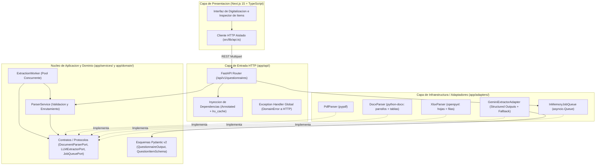
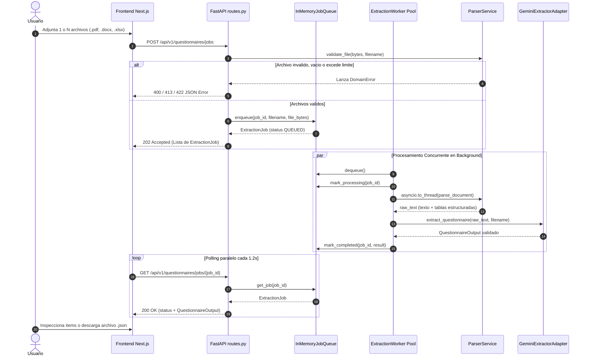
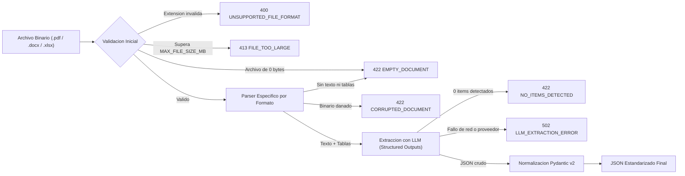

# Giunti Psychometrics — Digitalizador y Estructurador de Cuestionarios

[](https://www.python.org/)
[](https://fastapi.tiangolo.com/)
[](https://docs.pydantic.dev/)
[](https://nextjs.org/)
[](#suite-de-pruebas-automatizadas-pytest)

Aplicación web full-stack diseñada para digitalizar y estructurar automáticamente cuestionarios psicométricos y evaluaciones educativas desde documentos **PDF (`.pdf`)**, **Word (`.docx`)** y **Excel (`.xlsx`)** hacia un esquema JSON estandarizado y validado.

---

## Demo Pública en Producción (Deploy)

| Componente | Plataforma | URL Pública |
| :--- | :--- | :--- |
| **Aplicación Web Completa (Frontend + API Unificados)** | Render (Docker) | [https://questionnaires-to-json.onrender.com/](https://questionnaires-to-json.onrender.com/) |
| **Documentación Interactiva OpenAPI (Swagger UI)** | FastAPI `/docs` | [https://questionnaires-to-json.onrender.com/docs](https://questionnaires-to-json.onrender.com/docs) |
| **Health Check del Servicio** | FastAPI `/health` | [https://questionnaires-to-json.onrender.com/health](https://questionnaires-to-json.onrender.com/health) |

---

## Arquitectura del Sistema

El sistema está construido bajo los principios de **Arquitectura Hexagonal (Puertos y Adaptadores)** y **Procesamiento Asíncrono Desacoplado por Cola de Trabajos**. Esta separación garantiza que el núcleo de dominio (`domain/` y `services/`) sea independiente del framework HTTP, de las librerías de lectura documental y del proveedor de LLM.

### 1. Diagrama de Componentes (Puertos y Adaptadores)



---

### 2. Flujo de Procesamiento Asíncrono Concurrente (Cola + Workers)

Para evitar bloqueos HTTP prolongados y permitir el procesamiento de varios documentos en paralelo, el servidor gestiona una cola asíncrona (`InMemoryJobQueue`) consumida por un pool configurable de *workers* (`WORKER_CONCURRENCY`) inicializados durante el ciclo de vida (`lifespan`) de FastAPI:



---

### 3. Pipeline de Extracción, Inferencia y Validación de Esquema



---

## Estructura del Monorepo

```text
questionary_to_json/
├── Dockerfile                 # Imagen multi-stage unificada (compila Next.js y sirve todo desde FastAPI)
├── docker-compose.yml         # Levanta la aplicacion completa (UI + API) en el puerto 8000
├── README.md                  # Documentación técnica, arquitectura y supuestos
├── examples/                  # Cuestionarios de prueba (.pdf, .docx, .xlsx) y sus .json resultantes
│   ├── questionario_esempio_it.pdf
│   ├── questionario_esempio_it.json
│   ├── cuestionario_psicometrico_es.docx
│   ├── cuestionario_psicometrico_es.json
│   ├── cognitive_assessment_en.xlsx
│   └── cognitive_assessment_en.json
├── frontend/                  # Aplicación Web en Next.js 15 (App Router + TypeScript + Tailwind)
│   ├── .env.example
│   └── src/
│       ├── app/               # Vista principal de carga, estado de documentos y resultados
│       ├── components/        # QuestionnaireInspector (vista estructurada por tipo y visor JSON)
│       ├── lib/api.ts         # Capa centralizada y desacoplada de consumo de la API Backend
│       └── types/             # Contratos TypeScript espejo de los modelos Pydantic
└── backend/                   # API REST y Workers en Python 3.11+ y FastAPI
    ├── pyproject.toml         # Configuración de dependencias (uv), FastAPI CLI y Pytest
    ├── requirements.txt       # Dependencias exportadas para pip / Docker
    ├── .env.example
    ├── app/
    │   ├── main.py            # Entrypoint FastAPI, lifespan de workers, CORS y exception handlers
    │   ├── config.py          # Configuración tipada con pydantic-settings
    │   ├── domain/
    │   │   ├── schemas.py     # Modelos Pydantic v2 e invariantes de negocio
    │   │   ├── exceptions.py  # Excepciones semánticas de dominio
    │   │   └── ports.py       # Interfaces (Protocol) para Parsers, LLM y Cola
    │   ├── services/
    │   │   ├── parser_service.py     # Servicio validador y selector de estrategia de parsing
    │   │   └── extraction_worker.py  # Consumidor asíncrono de trabajos de extracción
    │   ├── adapters/
    │   │   ├── parsers/       # pdf_parser.py, docx_parser.py, xlsx_parser.py
    │   │   ├── llm/           # gemini_adapter.py y prompts.py
    │   │   └── queue/         # memory_queue.py (InMemoryJobQueue)
    │   └── api/
    │       ├── dependencies.py # Proveedores singletons y alias Annotated[..., Depends(...)]
    │       └── routes.py       # Endpoints HTTP (/jobs, /jobs/{job_id}, /extract)
    └── tests/                 # Suite de 32 tests unitarios y de integración
        ├── test_schemas.py
        ├── test_validators_and_parsers.py
        ├── test_llm_extractor.py
        └── test_api.py
```

---

## Supuestos de Interpretación y Decisiones de Diseño

De acuerdo con la indicación del documento de la prueba técnica (*"Ante cualquier duda de interpretación, documenta tu supuesto en el README y avanza"*), se detallan todos los supuestos funcionales y arquitectónicos adoptados:

### 1. Sin Persistencia en Base de Datos (Procesamiento Efímero en Memoria)
El enunciado de la prueba técnica solicita subir un documento, procesarlo y visualizar o descargar el JSON estandarizado resultante, sin requerir historial permanente, cuentas de usuario ni almacenamiento de cuestionarios a largo plazo. Por lo tanto, se asumió que **no es necesaria una base de datos persistente**:
- Los trabajos de extracción y sus estados (`QUEUED`, `PROCESSING`, `COMPLETED`, `FAILED`) se gestionan en memoria mediante `InMemoryJobQueue` durante la ejecución del servicio.
- Al estar desacoplada a través del contrato `JobQueuePort` (`app/domain/ports.py`), la arquitectura permite reemplazar la cola en memoria por un adaptador persistente (como Redis, PostgreSQL o AWS SQS + DynamoDB) sin modificar los servicios ni los endpoints.

### 2. Procesamiento por Cola Asíncrona + Endpoint Síncrono Directo
Dado que la extracción de documentos extensos mediante un LLM puede tomar varios segundos y un usuario puede requerir procesar varios archivos simultáneamente:
- Se diseñó un flujo asíncrono basado en cola (`POST /api/v1/questionnaires/jobs` y `GET /api/v1/questionnaires/jobs/{job_id}`) con un pool de *workers* concurrentes para procesar múltiples documentos en paralelo sin bloquear las peticiones HTTP.
- Adicionalmente, se mantuvo el endpoint síncrono `POST /api/v1/questionnaires/extract` que recibe un archivo y retorna directamente el JSON final en una sola llamada HTTP para facilitar pruebas directas desde Swagger UI, Postman o scripts automatizados.

### 3. Inferencia Autónoma sin Etiquetas Explícitas en el Documento
Se asume que los documentos reales **no** traen etiquetas de metadatos indicando el idioma (`"Idioma: es"`), el título explícito (`"Título: ..."`) ni el tipo de cada pregunta (`"Tipo: escala_likert"`):
- **Idioma (`idioma`):** Se detecta automáticamente a partir del vocabulario y la gramática del texto extraído, retornando su código ISO 639-1 de 2 letras en minúsculas (`"it"`, `"es"`, `"en"`, etc.) y preservando siempre el idioma original de los enunciados y alternativas sin traducirlos.
- **Título (`titulo`):** Se extrae del encabezado principal del documento o de la pestaña de cálculo; si el documento inicia directamente con las preguntas sin título visible, se infiere un título descriptivo en el idioma detectado.
- **Tipo de ítem (`tipo`):** Se deduce automáticamente analizando la estructura del enunciado y sus opciones de respuesta (escalas graduadas de frecuencia/acuerdo $\rightarrow$ `escala_likert`; opciones discretas A/B/C/D $\rightarrow$ `seleccion_multiple`; enunciados dicotómicos V/F o T/F $\rightarrow$ `verdadero_falso`; consignas de asociar dos listas/columnas $\rightarrow$ `emparejamiento`; preguntas abiertas sin opciones $\rightarrow$ `desarrollo`).

### 4. Representación del Tipo `"emparejamiento"` (*Matching*)
El documento de la prueba solicita identificar ítems de tipo `"emparejamiento"` manteniendo el esquema uniforme `alternativas: [{ "valor": ..., "texto": ... }]`. Como un cuestionario real puede venir sin respuestas resueltas (en blanco para ser administrado), no se deben fusionar previamente las columnas si no existe clave de corrección. Por ello:
- Cada premisa de la **Columna A** se incluye en `"alternativas"` con su identificador numérico en `"valor"` (`"1"`, `"2"`, `"3"`) y su texto en `"texto"`.
- Cada opción asociable de la **Columna B** se incluye en `"alternativas"` con su identificador de letra en `"valor"` (`"A"`, `"B"`, `"C"`) y su texto en `"texto"`.
- Si el documento incluye la clave de emparejamiento correcta, se consigna en `"respuesta_correcta"` como cadena de pares (ej. `"1-B, 2-C, 3-A"`); si no está indicada en el documento, `"respuesta_correcta"` es `null`.

```json
{
  "numero": 9,
  "enunciado": "Associ ciascuna funzione cognitiva (1-3) alla descrizione corrispondente (A-C):",
  "tipo": "emparejamiento",
  "alternativas": [
    { "valor": "1", "texto": "Memoria di lavoro" },
    { "valor": "2", "texto": "Attenzione selettiva" },
    { "valor": "3", "texto": "Controllo inibitorio" },
    { "valor": "A", "texto": "Capacità di inibire risposte impulsive" },
    { "valor": "B", "texto": "Mantenimento temporaneo ed elaborazione di dati" },
    { "valor": "C", "texto": "Focalizzazione su uno stimolo ignorando i distrattori" }
  ],
  "respuesta_correcta": "1-B, 2-C, 3-A"
}
```

### 5. Representación de `"verdadero_falso"`, `"escala_likert"` y `"desarrollo"`
- **`"escala_likert"`:** En concordancia con el ejemplo del PDF, los valores de `"alternativas"` en escalas Likert se normalizan siempre a enteros (`int`: `0, 1, 2, 3...`) mediante un validador `@model_validator(mode="after")` en Pydantic v2, y `"respuesta_correcta"` es `null`. Cuando un documento `.docx` o `.pdf` presenta varios ítems Likert dentro de una tabla donde la escala solo se nombra en el encabezado, el extractor propaga dichas alternativas a cada ítem de la tabla.
- **`"verdadero_falso"`:** Se estructura con sus dos alternativas en el idioma original del documento (`Vero`/`Falso` en italiano, `Verdadero`/`Falso` en español, `True`/`False` en inglés) y `"respuesta_correcta"` toma el identificador correspondiente (`"V"`, `"F"`, `"T"`) si está indicado, o `null` en caso contrario.
- **`"desarrollo"`:** El validador del modelo fuerza siempre `"alternativas": []` y `"respuesta_correcta": null`.
- **Autocálculo de `total_items`:** El modelo `QuestionnaireOutput` recalcula `total_items = len(items)` para garantizar que el conteo declarado coincida siempre con la cantidad real de ítems extraídos.

### 6. Documentos Digitales vs. Escaneos sin Capa de Texto y Documentos sin Ítems
- Se asume que los archivos `.pdf`, `.docx` y `.xlsx` contienen texto digital o tablas extraíbles (sin requerir OCR óptico sobre imágenes). Si se sube un PDF compuesto únicamente por imágenes escaneadas en blanco o sin texto seleccionable, el parser lanza `EmptyDocumentError` (`422 Unprocessable Entity`).
- Si se sube un documento válido con texto pero que **no corresponde a un cuestionario** (por ejemplo, una factura comercial o un texto informativo sin preguntas), el sistema detecta `0` ítems y lanza `NoItemsDetectedError` (`422 Unprocessable Entity`).

### 7. Fallback Automático entre Modelos Free Tier
Para mitigar picos de demanda (`503 UNAVAILABLE` o `429`) en la capa gratuita de Google AI Studio, `GeminiExtractorAdapter` implementa reintentos automáticos con *fallback* ordenado entre modelos gratuitos de la familia Flash (`gemini-3.5-flash-lite`, `gemini-3.1-flash-lite`, `gemini-3.7-flash`, `gemini-3.5-flash`, `gemini-2.5-flash`).

---

## Especificación de Endpoints y Manejo de Errores

### Endpoints Disponibles

| Método | Ruta | Código Éxito | Descripción |
| :--- | :--- | :---: | :--- |
| `POST` | `/api/v1/questionnaires/jobs` | `202 Accepted` | Recibe `1..N` archivos en el campo `files`, valida formato/tamaño y los encola para procesamiento asíncrono paralelo. |
| `GET` | `/api/v1/questionnaires/jobs/{job_id}` | `200 OK` | Devuelve el estado del trabajo (`QUEUED`, `PROCESSING`, `COMPLETED`, `FAILED`) y el JSON en `result` al finalizar. |
| `POST` | `/api/v1/questionnaires/extract` | `200 OK` | Recibe 1 archivo en el campo `file` y retorna directamente el JSON estandarizado (`QuestionnaireOutput`). |
| `GET` | `/health` | `200 OK` | Verificación de salud del servicio (`{"status": "ok"}`). |

### Códigos de Error Semánticos (`DomainError`)

| Excepción de Dominio | Código Interno (`code`) | HTTP Status | Caso en que se dispara |
| :--- | :--- | :---: | :--- |
| `UnsupportedFileFormatError` | `UNSUPPORTED_FILE_FORMAT` | `400 Bad Request` | Extensión distinta de `.pdf`, `.docx` o `.xlsx`. |
| `FileTooLargeError` | `FILE_TOO_LARGE` | `413 Content Too Large` | El archivo supera el límite configurado en `MAX_FILE_SIZE_MB`. |
| `CorruptedDocumentError` | `CORRUPTED_DOCUMENT` | `422 Unprocessable Entity` | Archivo binario dañado o ilegible por el parser correspondiente. |
| `EmptyDocumentError` | `EMPTY_DOCUMENT` | `422 Unprocessable Entity` | Archivo de 0 bytes, hoja de cálculo vacía o PDF sin texto extraíble. |
| `NoItemsDetectedError` | `NO_ITEMS_DETECTED` | `422 Unprocessable Entity` | El documento contiene texto válido pero ningún ítem de cuestionario. |
| `LLMExtractionError` | `LLM_EXTRACTION_ERROR` | `502 Bad Gateway` | Error de comunicación o configuración con el proveedor LLM. |

---

## Variables de Entorno

### Backend (`backend/.env`)
Plantilla disponible en [`backend/.env.example`](./backend/.env.example):

```env
APP_ENV=development
GEMINI_API_KEY=tu_api_key_gratuita_de_google_ai_studio
GEMINI_MODEL=gemini-3.5-flash-lite
MAX_FILE_SIZE_MB=20
WORKER_CONCURRENCY=3
```

### Frontend (`frontend/.env.local`)
Plantilla disponible en [`frontend/.env.example`](./frontend/.env.example):

```env
NEXT_PUBLIC_API_URL=http://localhost:8000
```

---

## Instrucciones de Instalación y Ejecución Local

### Opción 1: Ejecución Unificada con Docker (Recomendada)

El `Dockerfile` raíz utiliza un *multi-stage build* que compila estáticamente la aplicación Next.js (`output: "export"`) y la sirve directamente desde FastAPI mediante `app.frontend("/", directory=...)` en un único contenedor y puerto (`:8000`):

```bash
git clone <URL_DEL_REPOSITORIO>
cd questionary_to_json

cp backend/.env.example backend/.env
# Edita backend/.env y coloca tu GEMINI_API_KEY

docker compose up --build
```
- **Aplicación Web (Frontend + API unificados):** [http://localhost:8000](http://localhost:8000)
- **Swagger UI (OpenAPI):** [http://localhost:8000/docs](http://localhost:8000/docs)

---

### Opción 2: Ejecución Manual (Desarrollo Local)

#### 1. Iniciar el Backend (FastAPI)

Usando **`uv`**:
```bash
cd backend
cp .env.example .env
# Agrega tu GEMINI_API_KEY en backend/.env
uv sync
uv run fastapi dev
```

O usando **`venv` + `pip` estándar**:
```bash
cd backend
python -m venv .venv
source .venv/bin/activate
pip install -r requirements.txt
cp .env.example .env
# Agrega tu GEMINI_API_KEY en backend/.env
uvicorn app.main:app --reload --port 8000
```

#### 2. Iniciar el Frontend (Next.js)

En una segunda terminal:
```bash
cd frontend
cp .env.example .env.local
npm install
npm run dev
```
Accede a [http://localhost:3000](http://localhost:3000).

---

## Suite de Pruebas Automatizadas (Pytest)

El proyecto cuenta con **32 pruebas automatizadas** en `backend/tests/` que verifican:
1. **`test_schemas.py` (10 tests):** Validación del JSON de ejemplo del PDF de Giunti, soporte de los 5 tipos de ítems, rechazo de tipos inválidos, coerción de enteros en `escala_likert`, limpieza de alternativas en `desarrollo` y recálculo automático de `total_items`.
2. **`test_validators_and_parsers.py` (15 tests):** Rechazo de extensiones no soportadas (`.txt`, `.csv`, `.doc`, `.png`), archivos vacíos o que exceden el tamaño máximo, manejo de binarios corruptos en `.pdf`/`.docx`/`.xlsx`, extracción de párrafos y tablas en Word, hojas en Excel, páginas PDF y validación íntegra de la carpeta `/examples`.
3. **`test_llm_extractor.py` (3 tests):** Extracción estructurada con mocks del cliente Gemini, detección de `NoItemsDetectedError` cuando el documento retorna `items: []` y manejo de fallos de API/configuración.
4. **`test_api.py` (4 tests):** Pruebas de integración HTTP sobre `GET /health`, `POST /api/v1/questionnaires/extract`, mapeo de errores de dominio a códigos HTTP (`400`, `422`) y flujo asíncrono completo en `POST /api/v1/questionnaires/jobs` + `GET /api/v1/questionnaires/jobs/{job_id}`.

Para ejecutar toda la suite:
```bash
cd backend
uv run pytest -v
```

---

## Carpeta `/examples`

En [`/examples`](./examples) se encuentran **3 cuestionarios sintéticos de dominio público** (de 10 a 12 ítems cada uno, sin etiquetas artificiales de idioma o tipo) junto con sus archivos `.json` resultantes:

| Archivo de Entrada | JSON Resultante | Idioma | Total Ítems | Tipos de Ítems Cubiertos |
| :--- | :--- | :---: | :---: | :--- |
| [`questionario_esempio_it.pdf`](./examples/questionario_esempio_it.pdf) | [`questionario_esempio_it.json`](./examples/questionario_esempio_it.json) | `it` | 10 | `escala_likert`, `seleccion_multiple`, `verdadero_falso`, `emparejamiento`, `desarrollo` |
| [`cuestionario_psicometrico_es.docx`](./examples/cuestionario_psicometrico_es.docx) | [`cuestionario_psicometrico_es.json`](./examples/cuestionario_psicometrico_es.json) | `es` | 12 | Tabla `escala_likert`, `seleccion_multiple`, `verdadero_falso`, `emparejamiento`, `desarrollo` |
| [`cognitive_assessment_en.xlsx`](./examples/cognitive_assessment_en.xlsx) | [`cognitive_assessment_en.json`](./examples/cognitive_assessment_en.json) | `en` | 10 | Hoja de cálculo con `escala_likert`, `seleccion_multiple`, `verdadero_falso`, `emparejamiento`, `desarrollo` |
